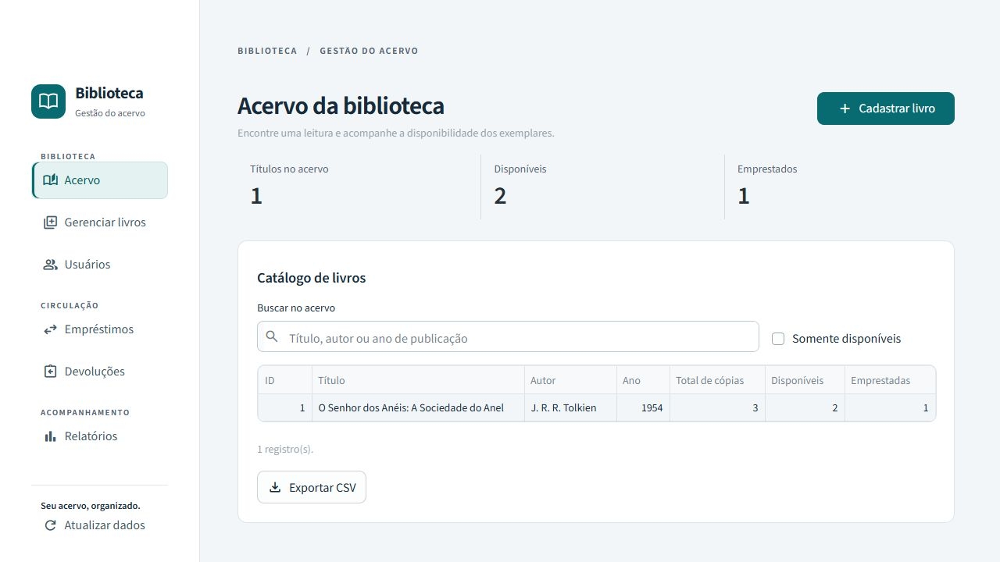

# Sistema de Gestão de Biblioteca

Projeto acadêmico em Python, Streamlit e SQLite. A interface abre no navegador, enquanto o aplicativo e o banco funcionam no computador que executa o Python.

## Obter o projeto

Baixe o repositório em **Code > Download ZIP**, extraia os arquivos e abra a pasta no VS Code. O repositório contém o código e os testes. O banco começa vazio; cadastre livros e usuários para experimentar as funções.

## Executar

Abra um terminal **dentro desta pasta**. Ambiente validado: Python 3.13.9, Streamlit 1.51.0 e pandas 2.3.3, no Windows.

```powershell
python -m pip install -r requirements.txt
python -m streamlit run app.py
```

Abra o endereço exibido no terminal, normalmente `http://localhost:8501`. Para encerrar, pressione `Ctrl+C` no terminal.

Depois de instalar as dependências no Python padrão, também é possível abrir `Iniciar_Biblioteca.bat` com dois cliques no Windows. Se usar o ambiente virtual abaixo, execute o comando que aponta para o Python desse ambiente.

Opcionalmente, antes de instalar, crie um ambiente virtual:

```powershell
python -m venv .venv
.venv\Scripts\python.exe -m pip install -r requirements.txt
.venv\Scripts\python.exe -m streamlit run app.py
```

Não é necessário instalar SQLite separadamente. Mantenha `app.py`, `biblioteca.py`, `database.py`, `visual.py` e a pasta `.streamlit` juntos. Copiar apenas `app.py` não é suficiente nesta versão modular.

## Funcionalidades

- Cadastro e edição de livros e usuários.
- Acréscimo de exemplares sem alterar empréstimos existentes.
- Pesquisa por título, autor ou ano, sem diferenciar maiúsculas e acentos.
- Empréstimos com verificação de disponibilidade e transação.
- Devoluções identificadas por número único, com proteção contra repetição.
- Relatórios de acervo, livros disponíveis, empréstimos ativos, usuários e histórico.
- Exportação CSV com separador `;` e codificação UTF-8 com BOM.
- Interface clara, navegação lateral por botões com ícones e indicadores na consulta do acervo.

## Arquivos

| Arquivo/pasta | Finalidade |
|---|---|
| `app.py` | Telas e interação com o usuário |
| `biblioteca.py` | Classe `Biblioteca`, validações e regras de negócio |
| `database.py` | Classe `BancoDados`, conexões, estrutura e migração |
| `visual.py` | Estilos e navegação lateral por botões |
| `.streamlit/config.toml` | Tema claro e configuração visual do Streamlit |
| `biblioteca.db` | Banco local criado automaticamente na primeira execução; não versionado |
| `schema.sql` | Estrutura SQL da versão revisada, para consulta |
| `requirements.txt` | Versões das dependências usadas na validação |
| `tests/` | Testes automatizados com bancos temporários |

## Dados e cópia de segurança

Por padrão, o banco fica ao lado de `database.py`, mesmo quando o programa é iniciado de outra pasta. Se não existir, um banco vazio será criado. Um banco com a estrutura original é migrado automaticamente; registros e identificadores são preservados. Datas antigas desconhecidas permanecem nulas e são exibidas como **Não registrada**. Novas datas são gravadas e exibidas em UTC.

Antes de usar outro banco legado, guarde uma cópia com o aplicativo fechado. A migração cancela integralmente se os dados violarem as novas restrições. Não substitua o banco enquanto o aplicativo estiver aberto.

A variável opcional `BIBLIOTECA_DB` permite escolher outro caminho, principalmente para testes e demonstrações. Os testes incluídos usam somente bancos temporários, sem alterar o banco principal.

## Rodar os testes

Os scripts `tests/test_biblioteca.py` e `tests/test_interface.py` verificam as regras, a migração do banco e os formulários. A validação registrada em 14 de novembro de 2026 aprovou 27 testes. Para repetir no seu ambiente:

```powershell
python -m unittest discover -s tests -v
```

O AppTest pode emitir o aviso `missing ScriptRunContext` durante a simulação; consulte o resultado final da suíte para identificar falhas reais.

## Roteiro rápido de demonstração

1. Cadastre um livro com uma cópia e um usuário fictício.
2. Pesquise o título, o autor e o ano na consulta.
3. Faça um empréstimo e confira a redução de disponibilidade.
4. Consulte os relatórios de empréstimos ativos e usuários.
5. Registre a devolução e confira a reposição da cópia.
6. Veja o histórico e baixe um relatório CSV.

## Limites desta versão

O sistema foi preparado para demonstração acadêmica e uso local. Não inclui login, permissões por perfil, exclusão de registros, multas, reservas ou prazo de devolução. A identificação é única após remover espaços nas extremidades, mas diferencia maiúsculas e minúsculas. O contato é obrigatório, sem validação especializada de CPF, telefone ou domínio de e-mail. A edição de nomes e títulos aparece também nas consultas do histórico; o histórico não armazena uma cópia antiga desses textos.

O estoque representa quantidades por registro de livro, não exemplares com código individual. Para publicar na internet, será necessário planejar autenticação, armazenamento persistente e cópias de segurança.

## Atualização visual

Se o aplicativo já estiver aberto, encerre o servidor com `Ctrl+C` e execute novamente `python -m streamlit run app.py` a partir da pasta do projeto. Recarregue a página do navegador. Se houver um tema escuro escolhido manualmente no navegador, selecione o tema personalizado em Configurações para seguir o tema claro do projeto.

A captura `previa_acervo.png` mostra o resultado com dados fictícios.

## Prévia


